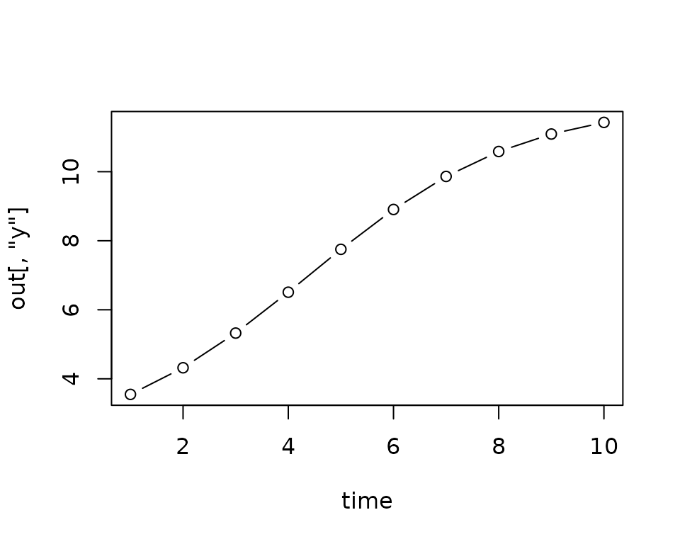
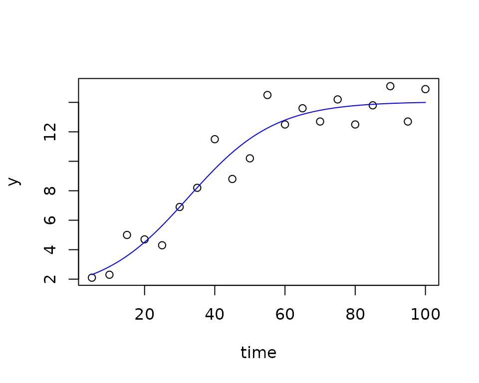
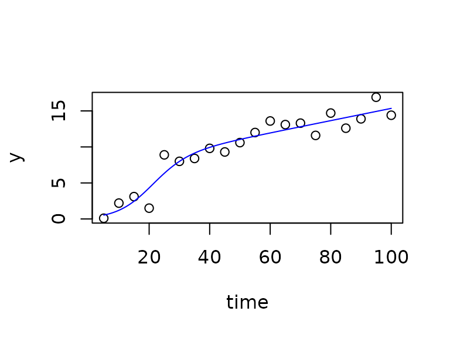

# Estimation of Growth Rates with Package \`growthrates\`, Part 2: User-defined Growth Models

## 1. Introduction

Package **growthrates** comes with a set of pararametric growth models
built-in, that should be sufficient for many application scenarios, but
of course not under all circumstances. This document describes how the
set of available functions can be extended with own user-defined models.
Section (3) describes how simple regression functions existing in a
*closed form* can be implemented. In Section (4) we will see how growth
models defined by systems of ordinary differential equations (ODE) can
be implemented directy in R and finally Section (5) describes how ODE
models can be implemented as C inline functions.

## 2. Differential equations or closed form?

Growth models can be either “ordinary functions” of time $`f(t)`$ in
*closed form*, that a allow to get values for the dependend variable
$`y`$ immediately from any given value of an independent variable $`t`$
(or $`time`$) without the need of iteration. Or, they can be a
differential equation model $`dy/dt`$ that needs numerical integration.

Sometimes, a model can be given in either of these forms. As an example,
the logistic growth model can be written as a differential equation:

``` math
\frac{dy}{dt} = \mu_{max} \cdot y \left(1 - \frac{y}{K}\right)
```

or as its analytical solution in closed form:

``` math
y(t) = \frac{K \cdot y_0}{y_0 + (K - y_0) \cdot e^{-\mu_{max} \cdot t}}
```

We see, that it is much easier to use the second form, because $`y`$ can
immediately be calculated from $`t`$, while for the first version, we
would need either calculus (and get the second form as its solution), or
we could use a numerical method to simulate the evolution of $`y`$
stepwise over time.

But on the other hand, models given as differential equations are often
more directly related to a mechanistic process description and easier to
extended.

## 3. Growth models in closed form

Let’s assume we want to extend the logistic growth model with an
additional shift parameter in $`y`$ direction, for example, because a
part of the population does not participate growing. This leads to an
equation like:

``` math
y(t) = \frac{K \cdot y_0}{y_0 + (K - y_0) \cdot e^{-\mu_{max} t}} + y_{shift}
```

After loading package growthrates:

``` r

library("growthrates")
```

we can immediately define our own function in the user workspace,
without modifying the package itself. In order to make it compatible
with package growthrates, it is sufficient to streamline the input and
output interfaces in the style described in help page
[`?growthmodel`](http://tpetzoldt.github.io/growthrates/reference/growthmodel-constructor.md).

The function can have any valid name, but:

1.  it must have exactly two arguments **time** and **parms** as input
    and
2.  its return value (output) must be a matrix with at least 2 columns
    with the column names `time` and `y`.

The inner part of the function can be adapted as necessary, as long as
the connection between input and output makes sense from a scientific
viewpoint.

``` r

grow_logistic_yshift <- function(time, parms) {
  with(as.list(parms), {
    y <- (K * y0) / (y0 + (K - y0) * exp(-mumax * time)) + y_shift
    as.matrix(data.frame(time = time, y = y))
  })
}
```

The, at a first look, circumstantial `as.matrix(data.frame(()))`
construction is just a simple way to create the required output format.

Then it is of course wise to test the function beforehand, for example:

``` r

time <- 1:10
out <- grow_logistic_yshift(time, parms = list(y0 = 1, mumax = 0.5, K = 10, y_shift = 2))
plot(time, out[, "y"], type = "b")
```



Future versions of the growthrates package may introduce additional
checks, so it is already a good idea to convert the function into an
appropriate object of class `growthmodel` with a so-called constructor
function of the same name:

    grow_logistic_yshift <- growthmodel(grow_logistic_yshift,
                                        c("y0", "mumax", "K", "y_shift"))

Now the new model is ready to be fitted to test data:

``` r

x <- seq(5, 100, 5)
y <- c(2.1, 2.3, 5, 4.7, 4.3, 6.9, 8.2, 11.5, 8.8, 10.2, 14.5, 12.5,
       13.6, 12.7, 14.2, 12.5, 13.8, 15.1, 12.7, 14.9)

fit <- fit_growthmodel(grow_logistic_yshift,
                       p = c(y0 = 1, mumax = 0.1, K = 10, K = 10, y_shift = 1),
                       time = x, y = y)
plot(fit)
```



``` r

summary(fit)
```

    ## 
    ## Parameters:
    ##         Estimate Std. Error t value Pr(>|t|)    
    ## y0       0.86510    1.15526   0.749 0.464826    
    ## mumax    0.08134    0.02737   2.972 0.008995 ** 
    ## K       12.99885    2.56970   5.059 0.000116 ***
    ## y_shift  1.04939    2.22481   0.472 0.643528    
    ## ---
    ## Signif. codes:  0 '***' 0.001 '**' 0.01 '*' 0.05 '.' 0.1 ' ' 1
    ## 
    ## Residual standard error: 1.248 on 16 degrees of freedom
    ## 
    ## Parameter correlation:
    ##              y0   mumax       K y_shift
    ## y0       1.0000 -0.9632  0.9555 -0.9477
    ## mumax   -0.9632  1.0000 -0.8989  0.8519
    ## K        0.9555 -0.8989  1.0000 -0.9766
    ## y_shift -0.9477  0.8519 -0.9766  1.0000

## 4. Differential equation models in R

Differential equation models can be used quite similar to this. It is a
little bit more complex because:

1.  we need two functions. One for the ODE model (the derivatives) and
    one for the numerical integration.
2.  the ODE model distinguishes between time dependent *state variables*
    and constant *parameters*, that can both be considered as
    *parameters* in a statistical sense. This distinction between
    **statistical parameters** (from the viewpoint of model fitting) and
    **ODE model parameters** should not be confused.
3.  the numerical integration itself is a broad field that needs
    experience and care. A short overview on this topic can be found in
    Soetaert et al. (2010).

In the following, let’s assume a model where the carrying capacity is a
function of time. This can be modelled with a system of two differential
equations, one for the carrying capacity ($`K`$) and another for the
population abundance ($`y`$). For sake of simplicity we assume a linear
increase of $`K`$, but more complex models are of course also possible,
e.g. biochemical conversion of a mixed substrate, Monod-dependency from
a limited resource, density dependence or a semi-continuos addition of
nutrients.

The growth model is built from two parts:

1.  the function `ode_...` with the differential equations, and
2.  the growth model `grow_...` calculating the numerical solution.

In the latter, the statistical parameters are splitted into the initial
values for the states (`init`) and the ODE model parameters. And, we
need to distinguish between the initial (start) values, e.g. $`y_0`$ and
the state variables $`y`$ that change during simulation.

``` r

ode_K_linear <- function (time, init, parms, ...) {
  with(as.list(c(parms, init)), {
    dy <- mumax * y * (1 - y/K)
    dK <- dK
    list(c(dy, dK))
  })
}

grow_K_linear <- function(time, parms, ...) {
  init    <- parms[c("y0", "K")]           # initial values
  names(init) <- c("y", "K")               # force names of state variables
  odeparms <- parms[c("mumax", "dK")]      # the parms of the ODE model
  out <- ode(init, time, ode_K_linear, parms = odeparms)
  out
}
```

Again, it’s a good idea to test this first:

``` r

grow_K_linear <- growthmodel(grow_K_linear,
                             pnames = c("y0", "K", "mumax", "deltaK"))
head(grow_K_linear(time = 1:10, c(y0 = .1, K = 1, mumax = 0.1, dK = 0.5)))
```

    ##      time         y   K
    ## [1,]    1 0.1000000 1.0
    ## [2,]    2 0.1095851 1.5
    ## [3,]    3 0.1203149 2.0
    ## [4,]    4 0.1322238 2.5
    ## [5,]    5 0.1453939 3.0
    ## [6,]    6 0.1599322 3.5

before we fit the model to data:

``` r

x <- seq(5, 100, 5)
y <- c(0.1, 2.2, 3.1, 1.5, 8.9, 8, 8.4, 9.8, 9.3, 10.6, 12, 13.6,
  13.1, 13.3, 11.6, 14.7, 12.6, 13.9, 16.9, 14.4)
fit <- fit_growthmodel(grow_K_linear,
                       p = c(y0 = 0.1, mumax = 0.2, K = 10, dK = .1), time = x, y = y)
plot(fit)
```



``` r

summary(fit)
```

    ## 
    ## Parameters:
    ##       Estimate Std. Error t value Pr(>|t|)    
    ## y0     0.53286    0.55248   0.964 0.349157    
    ## mumax  0.18124    0.07555   2.399 0.028988 *  
    ## K      7.76895    1.65802   4.686 0.000248 ***
    ## dK     0.08490    0.02375   3.575 0.002529 ** 
    ## ---
    ## Signif. codes:  0 '***' 0.001 '**' 0.01 '*' 0.05 '.' 0.1 ' ' 1
    ## 
    ## Residual standard error: 1.442 on 16 degrees of freedom
    ## 
    ## Parameter correlation:
    ##            y0   mumax       K      dK
    ## y0     1.0000 -0.9211  0.5040 -0.3791
    ## mumax -0.9211  1.0000 -0.6911  0.5596
    ## K      0.5040 -0.6911  1.0000 -0.9528
    ## dK    -0.3791  0.5596 -0.9528  1.0000

## 5. Inline C code with package cOde

A numerical simulation of ODE models can sometimes be slow, so we may be
tempted to speed it up. This is indeed possible with *compiled code*,
i.e. the model is written in another programming language (Fortran or C)
that are faster compared to R. Several methods exist how this can be
done, see for example Soetaert et al. (2010) or Kneis (2016) and Kneis
et al. (2017). In the following, we use a method that allows *inline
code*, i.e. direkt integration of C code in the R script using package
**cOde** (Kaschek 2016).

Note, however, that compiled code needs the necessary C (and/or Fortran)
compilers and some additional developer tools. These are often installed
on Linux systems by default, whereas the Windows toolset available from
<https://cran.r-project.org/bin/windows/Rtools/> needs an additional
installation.

``` r

## The following example shows how to use compiled growth models
## from inline code, by using the 'cOde' package of Daniel Kaschek
## Note: This example needs the R development tools.
##  - suitable compilers on Linux and Mac
##  - Rtools on Windows from https://cran.r-project.org/bin/windows/Rtools/

library("growthrates")
library("cOde")

## define a system of ODEs and compile it --------------------------------------
ode_K_linear <- funC(c(
  y = "mumax * y * (1-y/K)",
  K = "dK"
))

yini <- c(y = 1, K = 10)
parms = c(mumax = 0.1, dK = 0.05)

## run the model
out1 <- odeC(yini, times = 0:100, ode_K_linear, parms = parms)

## generate artificial test data with normal distributed noise
x <- seq(5, 100, 5)
y <- odeC(yini, x, ode_K_linear, parms)[, "y"] + rnorm(x)


## create a "growthmodel" with interfaces compatible to package growthrates
## It is essential to use consistent names for parameters and initial values!

grow_K_linear <- function(time, parms, ...) {
  init    <- parms[c("y0", "K")]  # initial values
  names(init) <- c("y", "K")      # force names
  out <- odeC(init, time, ode_K_linear, parms)
  out
}

## convert this to an object, (maybe needed by future extensions)
grow_K_linear <- growthmodel(grow_K_linear, pnames = c("y0", "mumax", "K", "dK"))

## Test the growthmodel
## Columns with names 'time' and 'y' are mandatory.
head(grow_K_linear(time = x, c(y0 = 1, mumax = 0.1, K = 10, dK = 0.1)))


## Fit the model ---------------------------------------------------------------
fit <- fit_growthmodel(grow_K_linear,
                       p = c(y0 = 1, mumax = 0.1, K = 10, dK = 0.1), time = x, y = y)
plot(fit)
summary(fit)

## Unload DLL and cleanup ------------------------------------------------------
## DLL creation should ideally be directed to a temporary directory.
dll <- paste(ode_K_linear, .Platform$dynlib.ext, sep = "")
dyn.unload(dll)
unlink(dll)
unlink(paste(ode_K_linear, ".c", sep = ""))
unlink(paste(ode_K_linear, ".o", sep = ""))
```

## Acknowledgments

Many thanks to Claudia Seiler for the data set, to David Kneis for
fruitful discussions, to Daniel Kaschek for his **cOde** package, and to
the R Core Team (R Core Team 2015) for developing and maintaining **R**.
This documentation was written using **knitr** (Xie 2014) and
**rmarkdown** (Allaire et al. 2015).

## References

Allaire, JJ, Joe Cheng, Yihui Xie, et al. 2015. *rmarkdown: Dynamic
Documents for r*. <https://CRAN.R-project.org/package=rmarkdown>.

Kaschek, Daniel. 2016. *code: Automated C Code Generation for Use with
the deSolve and bvpSolve Packages*.
<https://CRAN.R-project.org/package=cOde>.

Kneis, David. 2016. *rodeo: Handling of ODE-Models as r Objects*.
<https://github.com/dkneis/rodeo>.

Kneis, David, Thomas Petzoldt, and Thomas U. Berendonk. 2017. “An
r-Package to Boost Fitness and Life Expectancy of Environmental Models.”
*Environmental Modelling & Software* 96: 123–27.
https://doi.org/<https://doi.org/10.1016/j.envsoft.2017.06.036>.

R Core Team. 2015. *R: A Language and Environment for Statistical
Computing*. R Foundation for Statistical Computing.
<https://www.R-project.org/>.

Soetaert, Karline, Thomas Petzoldt, and R. Woodrow Setzer. 2010.
“Solving Differential Equations in R.” *The R Journal* 2 (2): 5–15.
<https://journal.r-project.org/archive/2010-2/RJournal_2010-2_Soetaert~et~al.pdf>.

Xie, Yihui. 2014. “knitr: A Comprehensive Tool for Reproducible Research
in R.” In *Implementing Reproducible Computational Research*, edited by
Victoria Stodden, Friedrich Leisch, and Roger D. Peng. Chapman;
Hall/CRC.
<https://www.routledge.com/Implementing-Reproducible-Research/Stodden-Leisch-Peng/p/book/9781466561595>.

------------------------------------------------------------------------

**Copyright and original author:**
[tpetzoldt](https://github.com/tpetzoldt), 2026-11-20
