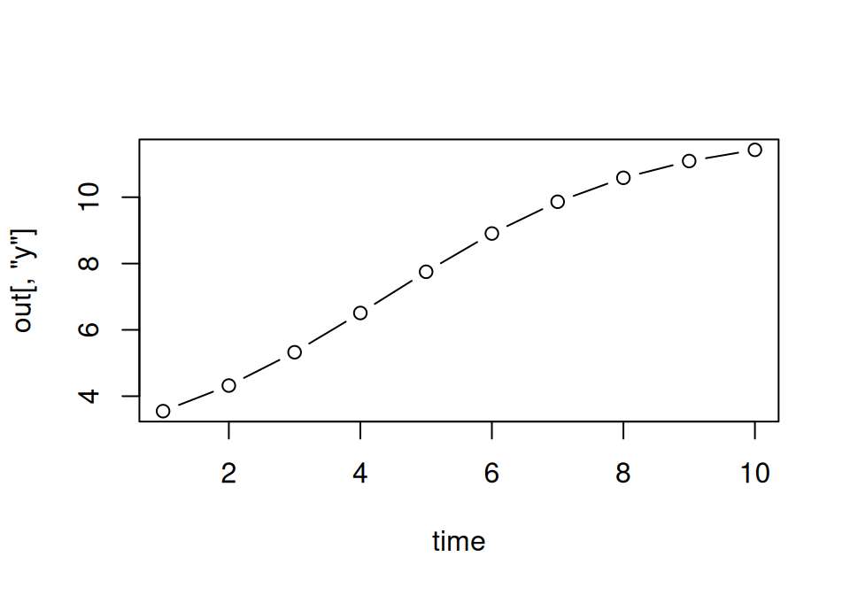
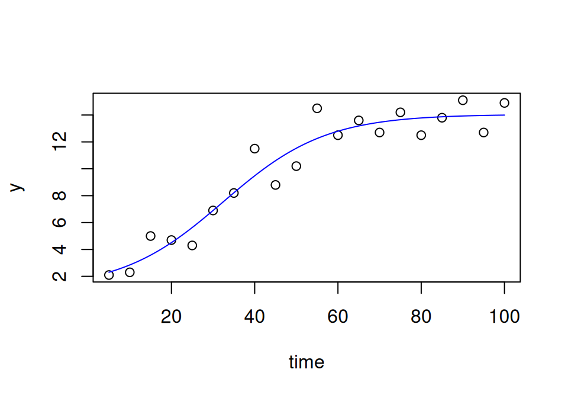
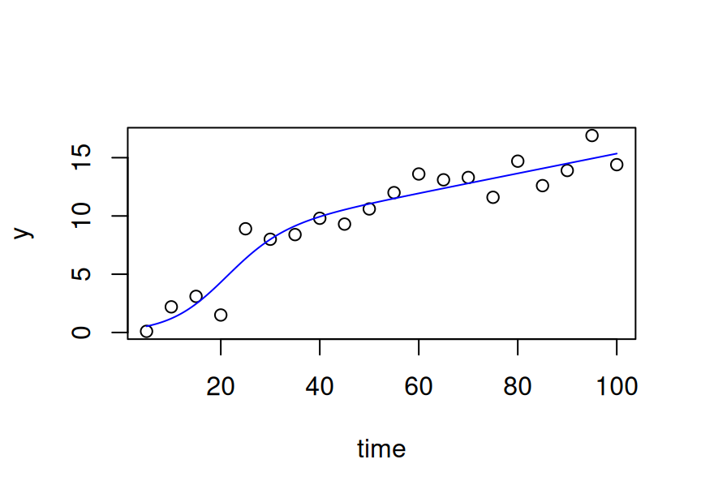

# Estimation of Growth Rates with Package `growthrates`, Part 2: User-defined Growth Models

## 1 Introduction

Package **growthrates** comes with a set of built-in parametric growth
models that should be sufficient for many application scenarios, though
of course not under all circumstances. This document describes how the
set of available functions can be extended with your own user-defined
models. Section 3 describes how simple regression functions existing in
*closed form* can be implemented. Section 4 shows how growth models
defined by systems of ordinary differential equations (ODEs) can be
implemented directly in R, and finally Section 5 describes how ODE
models can be implemented as inline C code.

## 2 Differential equations or closed form?

Growth models can be either “ordinary functions” of time $`f(t)`$ in
*closed form*—allowing you to obtain values for the dependent variable
$`y`$ immediately from any given value of an independent variable $`t`$
(or `time`) without iteration—or differential equation models $`dy/dt`$
that require numerical integration.

Sometimes a model can be written in either form. For example, the
logistic growth model can be expressed as a differential equation:

``` math
\frac{dy}{dt} = \mu_{\max} \cdot y \left(1 - \frac{y}{K}\right)
```

or as its analytical solution in closed form:

``` math
y(t) = \frac{K \cdot y_0}{y_0 + (K - y_0) \cdot e^{-\mu_{\max} \cdot t}}
```

The second form is much easier to evaluate because $`y`$ can be computed
directly from $`t`$, whereas the first version requires either
analytical integration (yielding the second form) or numerical
simulation of how $`y`$ evolves stepwise over time.

On the other hand, models formulated as differential equations are often
more directly tied to a mechanistic process description and easier to
extend.

## 3 Growth models in closed form

Suppose we want to extend the logistic growth model with an additional
shift parameter along the $`y`$-axis, for example because part of the
population does not participate in growth. This leads to an equation of
the form:

``` math
y(t) = \frac{K \cdot y_0}{y_0 + (K - y_0) \cdot e^{-\mu_{\max} t}} + y_{\text{shift}}
```

After loading package **growthrates**:

``` r

library("growthrates")
```

we can immediately define our own function in the user workspace without
modifying the package itself. To make it compatible with
**growthrates**, it is sufficient to follow the input and output
conventions described on the
[`?growthmodel`](http://tpetzoldt.github.io/growthrates/reference/growthmodel-constructor.md)
help page.

The function can have any valid name, provided that:

1.  it takes exactly two arguments, `time` and `parms`, as input, and
2.  its return value is a matrix with at least two columns named `time`
    and `y`.

The body of the function can be adapted as needed, as long as the
mapping between inputs and outputs makes sense from a scientific
perspective.

``` r

grow_logistic_yshift <- function(time, parms) {
  with(as.list(parms), {
    y <- (K * y0) / (y0 + (K - y0) * exp(-mumax * time)) + y_shift
    data.frame(time = time, y = y) |> as.matrix()
  })
}
```

At first glance, `data.frame(time = time, y = y) |> as.matrix()` may
look roundabout, but it is a straightforward way to produce the required
matrix format.

It is always good practice to test the function beforehand, for example:

``` r

time <- 1:10
out <- grow_logistic_yshift(time, parms = list(y0 = 1, mumax = 0.5, K = 10, y_shift = 2))
plot(time, out[, "y"], type = "b")
```



Future versions of **growthrates** may introduce additional checks, so
it is already helpful to wrap the function in a constructor of the same
name to create an object of class `growthmodel`:

``` r

grow_logistic_yshift <- growthmodel(grow_logistic_yshift,
                                    c("y0", "mumax", "K", "y_shift"))
```

Now the new model is ready to be fitted to test data:

``` r

x <- seq(5, 100, 5)
y <- c(2.1, 2.3, 5, 4.7, 4.3, 6.9, 8.2, 11.5, 8.8, 10.2, 14.5, 12.5,
       13.6, 12.7, 14.2, 12.5, 13.8, 15.1, 12.7, 14.9)

fit <- fit_growthmodel(grow_logistic_yshift,
                       p = c(y0 = 1, mumax = 0.1, K = 10, y_shift = 1),
                       time = x, y = y)
plot(fit)
```



``` r

summary(fit)
```


    Parameters:
            Estimate Std. Error t value Pr(>|t|)
    y0       0.86510    1.15526   0.749 0.464826
    mumax    0.08134    0.02737   2.972 0.008995 **
    K       12.99885    2.56970   5.059 0.000116 ***
    y_shift  1.04939    2.22481   0.472 0.643528
    ---
    Signif. codes:  0 '***' 0.001 '**' 0.01 '*' 0.05 '.' 0.1 ' ' 1

    Residual standard error: 1.248 on 16 degrees of freedom

    Parameter correlation:
                 y0   mumax       K y_shift
    y0       1.0000 -0.9632  0.9555 -0.9477
    mumax   -0.9632  1.0000 -0.8989  0.8519
    K        0.9555 -0.8989  1.0000 -0.9766
    y_shift -0.9477  0.8519 -0.9766  1.0000

## 4 Differential equation models in R

Differential equation models can be used in a similar way, though they
are slightly more involved because:

1.  we need two functions: one for the ODE model (the derivatives) and
    one for the numerical integration;
2.  an ODE model distinguishes between time-dependent *state variables*
    and constant *parameters*, even though both are treated as
    *parameters* during statistical estimation. This distinction between
    **statistical parameters** (from the perspective of model fitting)
    and **ODE model parameters** should be kept clear; and
3.  numerical integration is a broad topic that requires care and
    experience. A concise overview can be found in Soetaert et al.
    ([2010](#ref-Soetaert2010c)).

In the example below, we assume that the carrying capacity is a function
of time. This can be represented by a system of two differential
equations—one for the carrying capacity ($`K`$) and one for population
abundance ($`y`$). For simplicity, we assume a linear increase in $`K`$,
though more elaborate formulations are certainly possible, such as
biochemical conversion of a mixed substrate, Monod kinetics on a
limiting resource, density dependence, or semi-continuous nutrient
additions.

The growth model consists of two parts:

1.  a function `ode_...` defining the differential equations, and
2.  a growth model `grow_...` computing the numerical solution.

In the latter, the statistical parameters are split into initial values
for the state variables (`init`) and the ODE model parameters. We also
need to keep initial values (such as $`y_0`$) distinct from the state
variables (such as $`y`$) that evolve over time.

``` r

ode_K_linear <- function(time, init, parms, ...) {
  with(as.list(c(parms, init)), {
    dy <- mumax * y * (1 - y / K)
    dK <- dK
    list(c(dy, dK))
  })
}

grow_K_linear <- function(time, parms, ...) {
  init <- parms[c("y0", "K")]         # initial values
  names(init) <- c("y", "K")           # enforce state variable names
  odeparms <- parms[c("mumax", "dK")]  # ODE model parameters
  out <- ode(init, time, ode_K_linear, parms = odeparms)
  out
}
```

Again, it is wise to test the function first:

``` r

grow_K_linear <- growthmodel(grow_K_linear,
                             pnames = c("y0", "K", "mumax", "dK"))
grow_K_linear(time = 1:10, c(y0 = 0.1, K = 1, mumax = 0.1, dK = 0.5)) |> head()
```

         time         y   K
    [1,]    1 0.1000000 1.0
    [2,]    2 0.1095851 1.5
    [3,]    3 0.1203149 2.0
    [4,]    4 0.1322238 2.5
    [5,]    5 0.1453939 3.0
    [6,]    6 0.1599322 3.5

before fitting the model to data:

``` r

x <- seq(5, 100, 5)
y <- c(0.1, 2.2, 3.1, 1.5, 8.9, 8, 8.4, 9.8, 9.3, 10.6, 12, 13.6,
       13.1, 13.3, 11.6, 14.7, 12.6, 13.9, 16.9, 14.4)
fit <- fit_growthmodel(grow_K_linear,
                       p = c(y0 = 0.1, mumax = 0.2, K = 10, dK = 0.1),
                       time = x, y = y)
plot(fit)
```



``` r

summary(fit)
```


    Parameters:
          Estimate Std. Error t value Pr(>|t|)
    y0     0.53286    0.55248   0.964 0.349157
    mumax  0.18124    0.07555   2.399 0.028988 *
    K      7.76895    1.65802   4.686 0.000248 ***
    dK     0.08490    0.02375   3.575 0.002529 **
    ---
    Signif. codes:  0 '***' 0.001 '**' 0.01 '*' 0.05 '.' 0.1 ' ' 1

    Residual standard error: 1.442 on 16 degrees of freedom

    Parameter correlation:
               y0   mumax       K      dK
    y0     1.0000 -0.9211  0.5040 -0.3791
    mumax -0.9211  1.0000 -0.6911  0.5596
    K      0.5040 -0.6911  1.0000 -0.9528
    dK    -0.3791  0.5596 -0.9528  1.0000

## 5 Inline C code with package cOde

Numerical simulation of ODE models can occasionally be slow. Making
compiled code, i.e. writing the model in a language such as C or Fortran
that runs faster than R—an attractive option. Several approaches exist
for doing this; see, for example, Soetaert et al.
([2010](#ref-Soetaert2010c)), Kneis ([2016](#ref-Kneis2016)), and Kneis
et al. ([2017](#ref-Kneis2017)). Below, we use an approach that supports
*inline code*, integrating C code directly from an R script via package
**cOde** ([Kaschek 2016](#ref-Kaschek2016)).

Note, however, that compiled code requires appropriate C and/or Fortran
compilers along with developer tools. These are often pre-installed on
Linux, whereas Windows users need to install Rtools from
<https://cran.r-project.org/bin/windows/Rtools/>.

``` r

## Example of using compiled growth models from inline code via the 'cOde'
## package by Daniel Kaschek.
## Note: This example requires R development tools:
##  - suitable compilers on Linux and macOS
##  - Rtools on Windows from [https://cran.r-project.org/bin/windows/Rtools/](https://cran.r-project.org/bin/windows/Rtools/)

library("growthrates")
library("cOde")

## Define a system of ODEs and compile it --------------------------------------
ode_K_linear <- funC(c(
  y = "mumax * y * (1 - y / K)",
  K = "dK"
))

yini <- c(y = 1, K = 10)
parms <- c(mumax = 0.1, dK = 0.05)

## Run the model
out1 <- odeC(yini, times = 0:100, ode_K_linear, parms = parms)

## Generate synthetic test data with normally distributed noise
x <- seq(5, 100, 5)
y <- odeC(yini, x, ode_K_linear, parms)[, "y"] + rnorm(x)

## Create a 'growthmodel' with interfaces compatible with growthrates
## Consistent names for parameters and initial values are essential!
grow_K_linear <- function(time, parms, ...) {
  init <- parms[c("y0", "K")]  # initial values
  names(init) <- c("y", "K")    # enforce names
  out <- odeC(init, time, ode_K_linear, parms)
  out
}

## Convert to a 'growthmodel' object (may be required by future extensions)
grow_K_linear <- growthmodel(grow_K_linear, pnames = c("y0", "mumax", "K", "dK"))

## Test the growthmodel
## Columns named 'time' and 'y' are mandatory.
grow_K_linear(time = x, c(y0 = 1, mumax = 0.1, K = 10, dK = 0.1)) |> head()

## Fit the model ---------------------------------------------------------------
fit <- fit_growthmodel(grow_K_linear,
                       p = c(y0 = 1, mumax = 0.1, K = 10, dK = 0.1),
                       time = x, y = y)
plot(fit)
summary(fit)

## Unload DLL and clean up -----------------------------------------------------
## DLL creation should ideally be directed to a temporary directory.
dll <- paste(ode_K_linear, .Platform$dynlib.ext, sep = "")
dyn.unload(dll)
unlink(dll)
unlink(paste(ode_K_linear, ".c", sep = ""))
unlink(paste(ode_K_linear, ".o", sep = ""))
```

## 6 Acknowledgments

Many thanks to Claudia Seiler for the data set, to David Kneis for
fruitful discussions, to Daniel Kaschek for his **cOde** package, and to
the R Core Team ([R Core Team 2015](#ref-RCore2015)) for developing and
maintaining **R**. This documentation was written using **Quarto**
([Allaire and Dervieux 2025](#ref-quarto)).

## 7 References

Allaire, JJ, and Christophe Dervieux. 2025. *Quarto: R Interface to
’Quarto’ Markdown Publishing System*.
<https://doi.org/10.32614/CRAN.package.quarto>.

Kaschek, Daniel. 2016. *code: Automated C Code Generation for Use with
the deSolve and bvpSolve Packages*.
<https://CRAN.R-project.org/package=cOde>.

Kneis, David. 2016. *rodeo: Handling of ODE-Models as r Objects*.
<https://github.com/dkneis/rodeo>.

Kneis, David, Thomas Petzoldt, and Thomas U. Berendonk. 2017. “An
r-Package to Boost Fitness and Life Expectancy of Environmental Models.”
*Environmental Modelling & Software* 96: 123–27.
https://doi.org/<https://doi.org/10.1016/j.envsoft.2017.06.036>.

R Core Team. 2015. *R: A Language and Environment for Statistical
Computing*. R Foundation for Statistical Computing.
<https://www.R-project.org/>.

Soetaert, Karline, Thomas Petzoldt, and R. Woodrow Setzer. 2010.
“Solving Differential Equations in R.” *The R Journal* 2 (2): 5–15.
<https://journal.r-project.org/archive/2010-2/RJournal_2010-2_Soetaert~et~al.pdf>.
