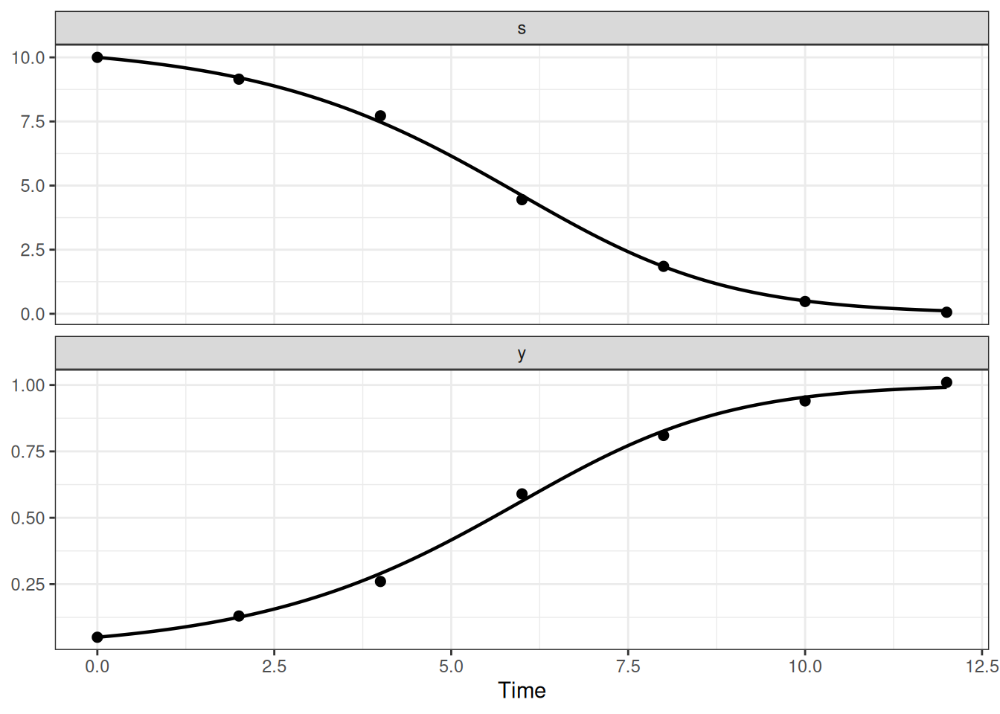

# Estimation of Growth Rates with Package `growthrates`, Part 3: Pipelines and Outlook

## 1 Overview

The **`growthrates`** package is designed to estimate growth rates
(especially $`\mu_{\max}`$) and curve parameters from a single response
time series, either via smoothing splines (`fit_splines()`,
[`all_splines()`](http://tpetzoldt.github.io/growthrates/reference/all_splines.md)),
linear fits to the exponential phase
([`fit_easylinear()`](http://tpetzoldt.github.io/growthrates/reference/fit_easylinear.md),
[`all_easylinear()`](http://tpetzoldt.github.io/growthrates/reference/all_easylinear.md)),
or parametric and ODE-based growth models (`fit_growthmodels()`,
[`all_growthmodels()`](http://tpetzoldt.github.io/growthrates/reference/all_growthmodels.md)).

This vignette illustrates:

1.  how batch analyses can be expressed with modern R pipelines instead
    of `all_*` functions (while keeping `all_*` intact for convenience
    and backward compatibility),
2.  why `growthrates` intentionally restricts fitting to a single
    response variable, and
3.  how to transition to multivariate dynamic systems using
    **`deSolve`** and **`FME`**.

## 2 Batch Analysis with Pipelines Instead of `all_*`

The `all_*` functions provide a compact formula interface for fitting
multiple groups at once. In many workflows, however, it is more flexible
to handle data preprocessing, error handling, and postprocessing
explicitly inside a pipeline—using either base R (`|>` with
[`split()`](https://rdrr.io/r/base/split.html) and
[`lapply()`](https://rdrr.io/r/base/lapply.html)) or `dplyr` / `purrr`.

``` r

library(growthrates)
```

### 2.1 Comparing `all_easylinear()` and a Base-R Pipeline

``` r

# Classic batch call across all groups in bactgrowth
fits_all <- all_easylinear(value ~ time | strain + replicate + conc,
                           data = bactgrowth, h = 6, quota = 0.95)

# Equivalent base-R pipeline without extra package dependencies
fits_pipe <- bactgrowth |>
  split(~ strain + replicate + conc) |>
  lapply(function(df) {
    fit_easylinear(df$time, df$value, h = 6, quota = 0.95)
  })

# Combine estimated coefficients into a data frame (matching futurize's key handling)
coefs_pipe <- do.call(
  rbind,
  lapply(names(fits_pipe), function(nm) {
    cf <- coef(fits_pipe[[nm]])
    data.frame(group = nm, as.list(cf), check.names = FALSE)
  })
)

head(coefs_pipe)
```

      group    y0       y0_lm     mumax       lag
    1 D.1.0 0.018 0.012348195 0.2048985 1.8392607
    2 R.1.0 0.011 0.008831178 0.2563043 0.8568207
    3 T.1.0 0.009 0.007109072 0.2651588 0.8894780
    4 D.2.0 0.014 0.012385312 0.2014899 0.6081994
    5 R.2.0 0.013 0.010416112 0.2407007 0.9206267
    6 T.2.0 0.013 0.011889052 0.2191126 0.4076961

### 2.2 Comparing `all_easylinear()` in a dplyr pipeline

When working with `dplyr`, you can group by the experimental factors and
fit
[`fit_easylinear()`](http://tpetzoldt.github.io/growthrates/reference/fit_easylinear.md)
per group before unpacking the estimated coefficients into columns.

``` r

library(dplyr)
library(tidyr)
library(purrr)

plan(multisession)

coefs_dplyr <- bactgrowth |>
  summarise(
    fit = list(
      fit_easylinear(time, value, h = 6, quota = 0.95)
    ),
    .by = c(strain, replicate, conc)
  ) |>
  mutate(coefs = map(fit, coef)) |>
  select(-fit) |>
  unnest_wider(coefs)

head(coefs_dplyr)
```

Using a pipeline is especially helpful when blank corrections, outlier
filtering, or [`tryCatch()`](https://rdrr.io/r/base/conditions.html)
guards for noisy individual wells need to be integrated directly into
the workflow.

### 2.3 Parallelization with `futurize`

A limitation of standard `dplyr` / `purrr` pipelines compared to the
`all_*` functions of `growthrates` (which accept `ncores`) is that they
run sequentially by default. With the **`futurize`** package ([Bengtsson
2025](#ref-Bengtsson2025_futurize)). You can parallelize map-reduce
calls such as [`lapply()`](https://rdrr.io/r/base/lapply.html) or
[`purrr::map()`](https://purrr.tidyverse.org/reference/map.html) by
selecting a **`future`** backend ([Bengtsson
2021a](#ref-Bengtsson2021_future)) (`plan(multisession)`) and piping the
mapping step into `futurize()`.

Note that `futurize` relies on optional backend packages depending on
which mapping function you use: **`future.apply`** ([Bengtsson
2021b](#ref-Bengtsson2021_future_apply)) would be required to transpile
base R’s [`lapply()`](https://rdrr.io/r/base/lapply.html), whereas
**`furrr`** ([Vaughan and Dancho 2022](#ref-Vaughan2022_furrr)) is
required to transpile
[`purrr::map()`](https://purrr.tidyverse.org/reference/map.html). You
can check which namespaces are currently supported in your installation
with
[`futurize::futurize_supported_packages()`](https://futurize.futureverse.org/reference/futurize_supported_packages.html).

Because fitting the models themselves do the main work, splitting the
grouped data into a list first lets `futurize()` distribute
[`fit_easylinear()`](http://tpetzoldt.github.io/growthrates/reference/fit_easylinear.md)
across worker sessions:

``` r

library(dplyr)
library(tidyr)
library(purrr)

plan(multisession) # enables multicore computations

splits <- bactgrowth |>
  split(~ strain + replicate + conc)

coefs_futurize <- names(splits) |>
  map(\(nm) {
    df <- splits[[nm]]
    cf <- coef(fit_easylinear(df$time, df$value, h = 6, quota = 0.95))
    c(list(group = nm), as.list(cf)) |>
      as_tibble()
  }) |>
  futurize() |>
  list_rbind()

plan(sequential) # resets to single core computation
head(coefs_futurize)
```

## 3 Outlook: Multivariate ODE Fits

When multiple state variables are measured simultaneously, such as
biomass alongside substrate depletion or product formation, joint
fitting can help identify parameters like half-saturation constants
($`K_s`$) or yield coefficients that remain correlated or weakly
constrained from growth curves alone. Both
[`fit_growthmodel()`](http://tpetzoldt.github.io/growthrates/reference/fit_growthmodel.md)
and `all_growthmodel()`—like the non-parametric methods in
`growthrates`—intentionally focus on **one dependent response variable**
at a time. Even when a user-defined ODE model tracks multiple internal
state variables, such as biomass `y` and substrate `s`, the built-in
objective function evaluates residuals against a single observed
response.

This single-response design keeps the interface focused and transparent
for routine growth-curve analysis, avoiding added complexity around:

- **different units and scales**, e.g., $`\text{OD}_{600}`$ values
  between `0.01` and `1.5` vs. substrate concentrations in `mmol/L` or
  fluorescence intensities,
- **weighting and error structure**, where appropriate scaling across
  variables depends on measurement noise, replication, and experimental
  priorities rather than a universal default, and
- **more complex return objects, plotting, and batch methods** across
  grouped datasets.

Even with a single observed response, multi-state ODE models in
`growthrates` remain useful whenever mechanistic coupling shapes the
trajectory of the measured variable. When true multi-response fitting
across several observed state variables is required, you can pass a
custom cost or objective function built on `growthrates` model functions
or use dedicated nonlinear/inverse-modeling frameworks such as **`FME`**
([Soetaert and Petzoldt 2010](#ref-Soetaert2010)). For most batch and
plate-reader workflows, however, fitting the primary growth response
directly—and using additional measurements as independent checks or
covariates—keeps models easier to diagnose and reproduce.

### 3.1 Multivariate ODE Fits with `deSolve` and `FME`

In the interest of full flexibility and power, switching directly to
**`deSolve`** and **`FME`** ([Soetaert et al. 2010](#ref-deSolve_jss);
[Soetaert and Petzoldt 2010](#ref-Soetaert2010)) is the natural next
step. Together, they let you model coupled dynamics across multiple
observed states while retaining full control over numerical solvers,
variable scaling, and parameter estimation algorithms.

### 3.2 Core Workflow

1.  Define the coupled ODE system as a standard derivative function for
    [`deSolve::ode()`](https://rdrr.io/pkg/deSolve/man/ode.html).
2.  Use [`FME::modCost()`](https://rdrr.io/pkg/FME/man/modCost.html) to
    combine residuals across multiple observed variables with explicit
    scaling and weighting.
3.  Optimize parameters with
    [`FME::modFit()`](https://rdrr.io/pkg/FME/man/modFit.html).

``` r

library(deSolve)
library(FME)
```

    Loading required package: rootSolve

    Loading required package: coda

``` r

# Coupled Monod model with biomass (y) and substrate (s)
monod_ode <- function(time, state, parms) {
  with(as.list(c(state, parms)), {
    mu <- mumax * s / (Ks + s)
    dy <- mu * y
    ds <- -dy / yield
    list(c(dy, ds))
  })
}

# Example objective function for two observed variables (columns: time, y, s)
obj_fun <- function(p, obs_df, y0) {
  out <- ode(y = y0, times = obs_df$time, func = monod_ode, parms = p)
  modCost(model = out, obs = obs_df, x = "time", weight = "std")
}

# Example observed dataset with two measured state variables
obs_df <- data.frame(
  time = c(0, 2, 4, 6, 8, 10, 12),
  y    = c(0.05, 0.13, 0.26, 0.59, 0.81, 0.94, 1.01),
  s    = c(10.0, 9.15, 7.72, 4.45, 1.85, 0.48, 0.06)
)

p_start <- c(mumax = 0.6, Ks = 1.0,  yield = 0.1)
p_lower <- c(mumax = 0,   Ks = 1e-6, yield = 1e-6)
p_upper <- c(mumax = 10,  Ks = 100,  yield = 5)
fit_mv <- modFit(f = obj_fun, p = p_start, lower = p_lower, upper = p_upper,
                  obs_df = obs_df, y0 = c(y = 0.05, s = 10))
summary(fit_mv)
```


    Parameters:
           Estimate Std. Error t value Pr(>|t|)
    mumax  1.352167   0.457580   2.955   0.0131 *
    Ks    18.750281   8.776841   2.136   0.0560 .
    yield  0.095233   0.000265 359.420   <2e-16 ***
    ---
    Signif. codes:  0 '***' 0.001 '**' 0.01 '*' 0.05 '.' 0.1 ' ' 1

    Residual standard error: 0.04394 on 11 degrees of freedom

    Parameter correlation:
           mumax     Ks  yield
    mumax 1.0000 0.9996 0.7324
    Ks    0.9996 1.0000 0.7320
    yield 0.7324 0.7320 1.0000

### 3.3 Visualizing the Coupled Monod Fit

Once the multivariate fit is obtained with
[`FME::modFit()`](https://rdrr.io/pkg/FME/man/modFit.html), you can
define the initial state vector `y0` explicitly, simulate the fitted
trajectory on a finer time grid with
[`deSolve::ode()`](https://rdrr.io/pkg/deSolve/man/ode.html), and plot
both observed points and model curves side by side with `ggplot2` (using
facets so biomass `y` and substrate `s` keep their own scales).

``` r

library(ggplot2)
library(tidyr)

y0 <- c(y = 0.05, s = 10)
time_fine <- seq(min(obs_df$time), max(obs_df$time), length.out = 200)
sim_df <- as.data.frame(
  ode(y = y0, times = time_fine, func = monod_ode, parms = coef(fit_mv))
)

obs_long <- pivot_longer(obs_df, cols = c(y, s),
                         names_to = "variable", values_to = "value")
sim_long <- pivot_longer(sim_df, cols = c(y, s),
                         names_to = "variable", values_to = "value")

ggplot() +
  geom_line(data = sim_long, aes(x = time, y = value), linewidth = 0.8) +
  geom_point(data = obs_long, aes(x = time, y = value), size = 2) +
  facet_wrap(~ variable, scales = "free_y", ncol = 1) +
  labs(x = "Time", y = NULL) +
  theme_bw()
```



## 4 Summary

- **`growthrates`** provides a lightweight, script-friendly workflow for
  estimating growth rates and curve parameters from a **single**
  response variable.
- It includes `all_*` functions for fitting multiple data sets or models
  within the package, and it can also be integrated into broader data
  pipelines.
- Fitting models with **multiple** state variables is possible by
  combining **`deSolve`** and **`FME`** ([Soetaert et al.
  2010](#ref-deSolve_jss); [Soetaert and Petzoldt
  2010](#ref-Soetaert2010)). Together, they support mechanistic dynamic
  modeling with multiple observed state variables, explicit residual
  weighting, and parameter identifiability analysis.

Depending on your experimental setup and analytical pipeline,
complementary packages can round out the workflow—whether for importing
plate-reader data directly, analyzing dose-response relationships, or
building an interactive Shiny interface.

## 5 Acknowledgments

Many thanks to the R Core Team ([R Core Team 2015](#ref-RCore2015)) for
developing and maintaining **R**. This documentation was written using
**Quarto** ([Allaire and Dervieux 2025](#ref-quarto)).

## 6 References

Allaire, JJ, and Christophe Dervieux. 2025. *Quarto: R Interface to
’Quarto’ Markdown Publishing System*.
<https://doi.org/10.32614/CRAN.package.quarto>.

Bengtsson, Henrik. 2021a. “A Unifying Framework for Parallel and
Distributed Processing in r Using Futures.” *The R Journal* 13 (2):
208–27. <https://doi.org/10.32614/RJ-2021-048>.

Bengtsson, Henrik. 2021b. *Future.apply: Apply Function to Elements in
Parallel Using Futures*.
<https://CRAN.R-project.org/package=future.apply>.

Bengtsson, Henrik. 2025. *Futurize: Parallelize Common Functions via One
Magic Function*. <https://CRAN.R-project.org/package=futurize>.

R Core Team. 2015. *R: A Language and Environment for Statistical
Computing*. R Foundation for Statistical Computing.
<https://www.R-project.org/>.

Soetaert, Karline, and Thomas Petzoldt. 2010. “Inverse Modelling,
Sensitivity and Monte Carlo Analysis in Using Package .” *Journal of
Statistical Software* 33 (3): 1–28.
<https://doi.org/10.18637/jss.v033.i03>.

Soetaert, Karline, Thomas Petzoldt, and R. Woodrow Setzer. 2010.
“Solving Differential Equations in : Package .” *Journal of Statistical
Software* 33 (9): 1–25. <https://doi.org/10.18637/jss.v033.i09>.

Vaughan, Davis, and Matt Dancho. 2022. *Furrr: Apply Mapping Functions
in Parallel Using Futures*. <https://CRAN.R-project.org/package=furrr>.
